

# 🐄 Cattle Feed Billing — श्री गणेश ट्रेडर्स

**Counter billing, live stock, payments & sales reports for a cattle-feed dealer.**  
Built for real daily shop operations — write a bill, reduce stock in the same step, take payments, and review the day from phone or desktop.

  
  

  
  
  
  
  
  

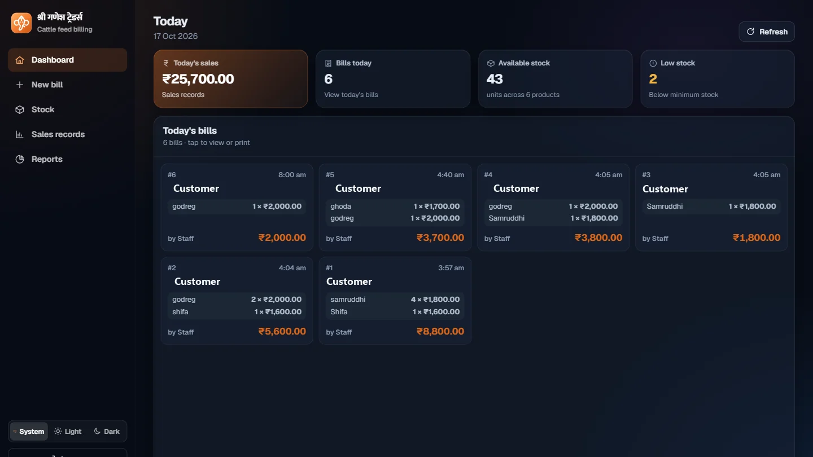

---

> **🔒 Intellectual Property Notice**  
> This repository is a **public case study & architecture showcase**.  
> It does **not** contain the application source code, and the project is **not open source**.  
> The full application source is maintained in a private repository by **[Nexora Studio](https://software-studio.nexoralab.workers.dev/)**.  
> Customer names and mobile numbers in the screenshots are masked.

---

## 🏪 Overview

The shop sells cattle feed at the counter. Every sale must:

- Produce a printable / WhatsApp-ready Marathi bill  
- Reduce stock in the same atomic step  
- Track partial or pending payments  
- Surface low-stock warnings and period reports  

The application is the digital counter desk — usable on phone (bottom navigation) or larger screens (sidebar). Shop screens require sign-in; every bill records who wrote it.

---

## 🚀 Key Features Engineered

### 1. 🧾 Counter Billing with Stock Guard
- Search products → see rate, units in stock and low-stock mark before adding a line  
- Quantity + optional one-off rate per line  
- Save is refused, naming each product that is short, if stock is insufficient  
- One transaction updates bill + stock + payment status together  

### 2. 📦 Live Stock & Low-Stock Alerts
- Add / restock / edit rate & minimum  
- Products under minimum highlighted on Dashboard, product search and Stock list  

### 3. 👥 Customer Lookup by Mobile
- Mobile number is the unique key  
- Later visits bring back name, previous bills and outstanding dues  

### 4. 💰 Payments
- Bill can be Paid / Partly paid / Pending (cash or online)  
- Later payments recorded against the customer  

### 5. 🖨️ Print & WhatsApp
- Marathi bill layout for the counter  
- PDF + private shareable link (customer needs no account)  

### 6. 📊 Sales & Reports
- Period filter, newest-first list, period total  
- Charts (trend, product share, top customers, billers)  
- Busy-hours heatmap  
- Excel download of the filtered period (summary, products, customers, bills & lines, low stock, etc.)

---

## 📸 Screenshot Gallery

### Dashboard
Day’s sales, bill count, stock on hand and low-stock count.

Phone layout (light theme). Supports light / dark / system.

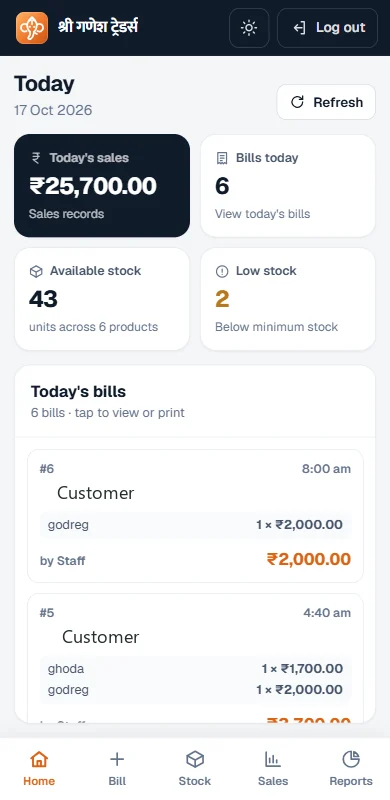

### Billing
Product search with stock levels → filled bill → Marathi print / WhatsApp preview.

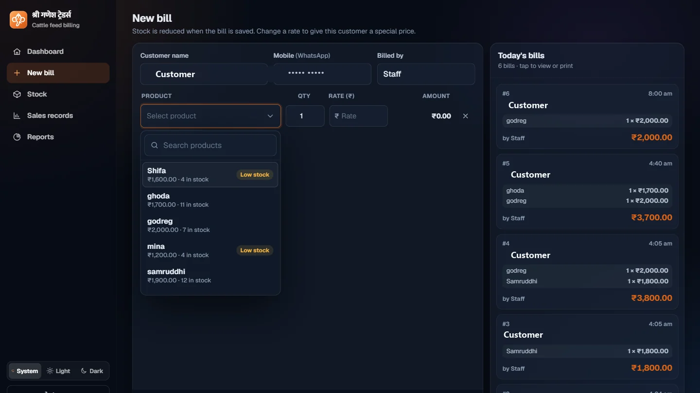
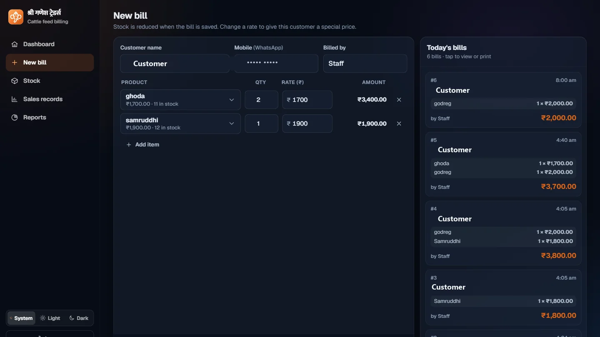
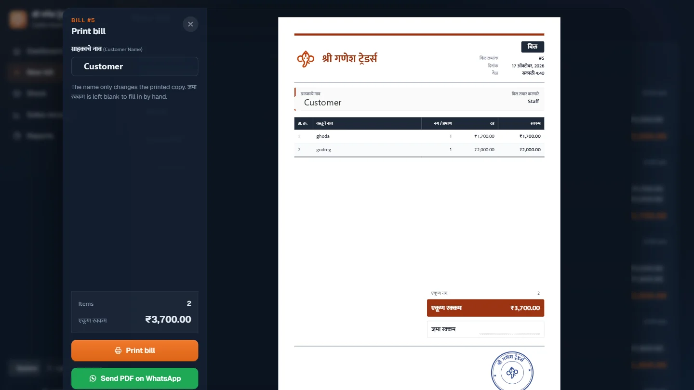

### Stock & Sales
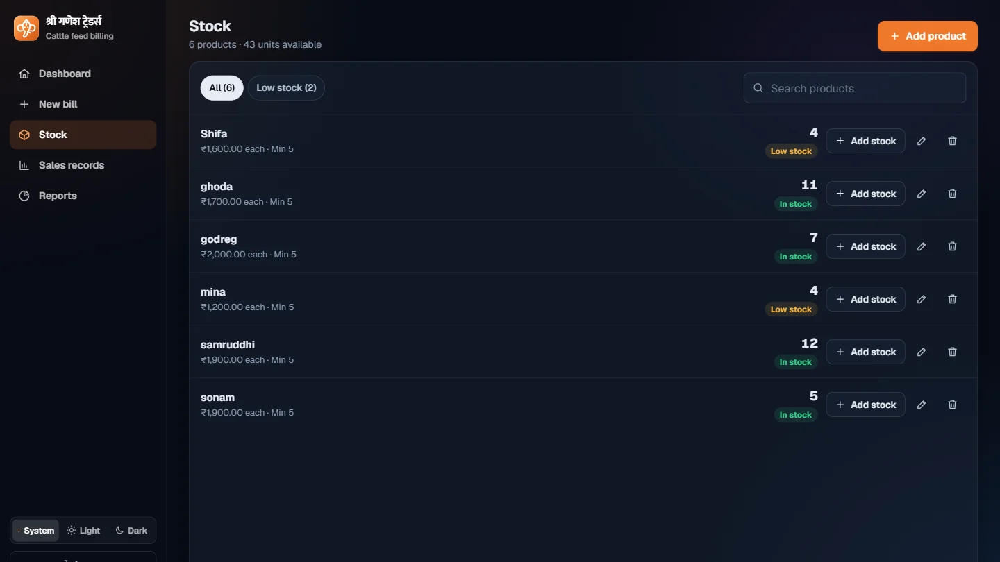
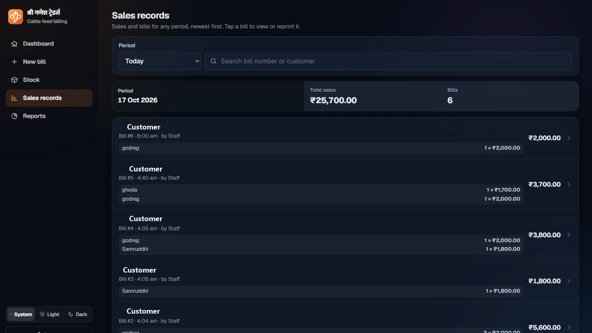

### Reports
Summary vs previous period, charts and detailed tables.

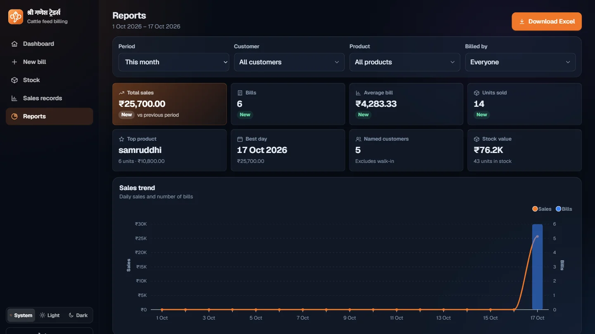
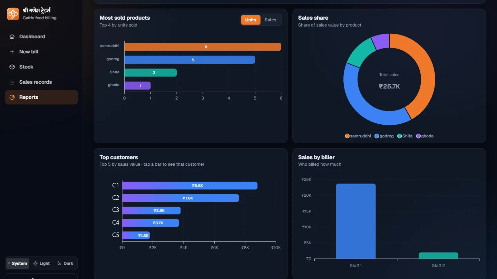
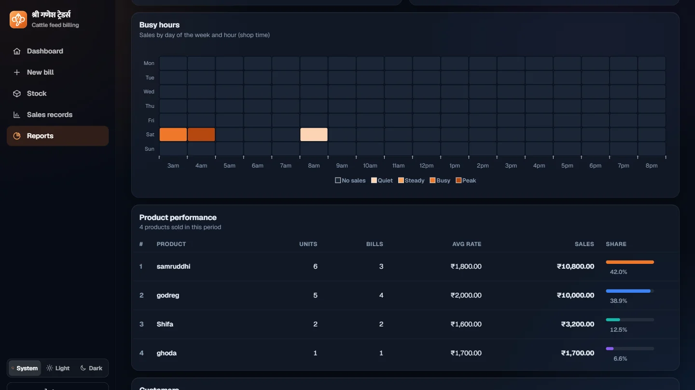

---

## 🏗️ System Architecture

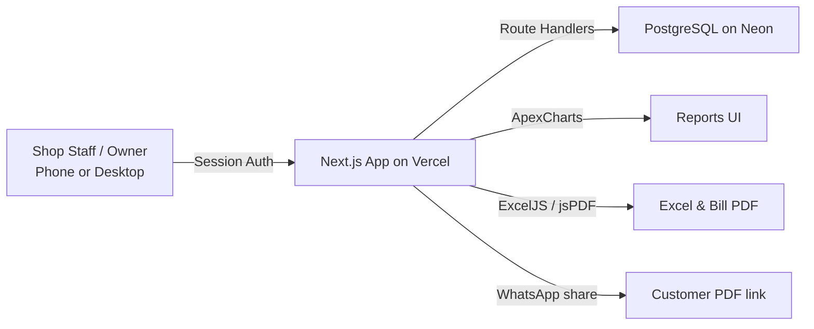

---

## ⚡ Technical Highlights

| Area | Stack |
|------|--------|
| Interface | Next.js 16 · React 19 · TypeScript · Tailwind CSS 4 |
| API | Next.js Route Handlers (same project) |
| Database | Neon PostgreSQL |
| Auth | Shop account · session cookie · hashed passwords · failed-attempt limit |
| Charts & Files | ApexCharts · ExcelJS · jsPDF |
| Hosting | Vercel |

- Atomic bill + stock update (quantity check + write in one step)  
- Customer identity by mobile number  
- Period-over-period report comparison  
- Full Marathi bill layout  
- Responsive: bottom nav on phone, sidebar on larger screens  

---

## 🔄 Typical Daily Workflow

1. Sign in  
2. Glance at **Today** (sales, bills, stock, low-stock)  
3. Write bill → search product → set qty / rate → mark payment status  
4. Save → bill + stock + payment stored together  
5. Print Marathi bill or send PDF + private link on WhatsApp  
6. Restock, record later payments, review Sales / download Excel report  

---

## 📬 Architected & Delivered By

**Shubham Deshmukh** — Founder & Lead Developer at **[Nexora Studio](https://software-studio.nexoralab.workers.dev/)**

- 🌐 Studio: [software-studio.nexoralab.workers.dev](https://software-studio.nexoralab.workers.dev/)  
- 💼 LinkedIn: [shubham-deshmukh1720](https://www.linkedin.com/in/shubham-deshmukh1720)  
- 💻 GitHub: [@shubhamdsk](https://github.com/shubhamdsk)
